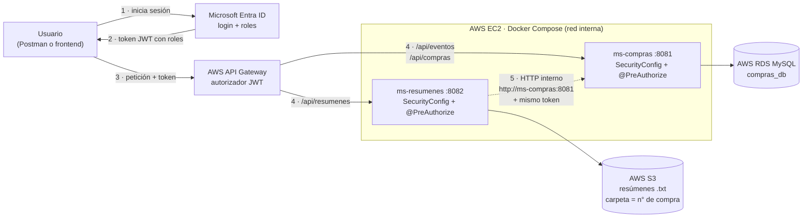

# Eventos Microservicios · AWS API Gateway + EntraID


Sistema de venta de entradas para eventos. Separación en 2 microservicios Spring Boot que corren en una EC2 con Docker. Las compras se guardan en RDS (MySQL) y los resúmenes de compra en S3. Para autenticar se usa Microsoft Entra ID (login y roles) y todas las peticiones pasan por AWS API Gateway. El despliegue es automático con GitHub Actions.

## Microservicios

Para ver detalle de cada microservicio haz click en su nombre

| Microservicio | Qué hace | Guarda en | Puerto |
|---|---|---|---|
| [**ms-compras**](ms-compras/README.md) | Eventos y compras de entradas | RDS MySQL | 8081 |
| [**ms-resumenes**](ms-resumenes/README.md) | Resumen de compra (archivo y S3) | S3 | 8082 |


## Flujo completo




1. **Ver eventos:** `GET /api/eventos` público, no pide iniciar sesión.
2. **Login:** para comprar, el usuario inicia sesión en Entra ID y recibe un **token (JWT)** con sus roles.
3. **API Gateway:** todas las peticiones van al Gateway con el token. El autorizador revisa que sea válido; si no, responde **401** y la petición ni siquiera llega a la EC2.
4. **Microservicio:** Spring Security vuelve a validar el token y revisa el **rol** con `@PreAuthorize`.
5. **Comunicación interna (línea punteada):** ms-resumenes le pide los datos de la compra a ms-compras por **HTTP interno**, dentro de la red de Docker en la misma EC2 (`http://ms-compras:8081`). Esta llamada **no pasa por el API Gateway**. Como ms-compras también exige token, ms-resumenes le **reenvía el mismo token del usuario** (*token relay*), y así ms-compras revisa que la compra sea de esa persona y siga activa antes de tocar S3.

## Roles

Los roles se asignan en Entra ID (*Aplicaciones empresariales → Usuarios y grupos*) y llegan en el claim `roles` del token.

| Rol | Qué puede hacer |
|---|---|
| **ADMIN** | Todo: crear eventos, comprar, ver cualquier compra (incluso desactivadas), desactivar compras y borrar resúmenes de S3 |
| **VENDEDOR** | Crear eventos |
| **CLIENTE** | Comprar, ver sus compras y manejar sus resúmenes |


## Seguridad en capas

Cada petición tiene que pasar 4 filtros. Si falla en uno, se corta ahí mismo:

```text
  Petición con token
        │
        ▼
  1. API Gateway ........ ¿El token es válido? ..................... ✖ 401
        │ ✔
        ▼
  2. SecurityConfig ..... ¿Firma, emisor, audiencia y expiración? .. ✖ 401
        │ ✔
        ▼
  3. @PreAuthorize ...... ¿Tu rol puede usar este endpoint? ........ ✖ 403
        │ ✔
        ▼
  4. Service ............ ¿La compra es tuya y está activa? ........ ✖ 403 / 404
        │ ✔
        ▼
  Respuesta
```

> Si alguien llama directo a la EC2 saltándose el Gateway, igual recibe **401**: cada microservicio valida el token por su cuenta.

## Despliegue (GitHub Actions) pipeline CI/CD 

Cada push a `main` ejecuta `.github/workflows/deploy.yml`:

```text
  push a main
        │
        ▼
  1. tests ........ mvn verify de cada microservicio
        │
        ▼
  2. docker ....... publica las 2 imágenes en Docker Hub
        │
        ▼
  3. deploy-ec2 ... copia el compose, hace pull + up y prueba /salud (8081 y 8082)
```

### Secrets

*Settings → Secrets and variables → Actions → pestaña **Secrets***

| Para qué | Secrets |
|---|---|
| Docker Hub | `DOCKERHUB_USERNAME` · `DOCKERHUB_TOKEN` |
| EC2 | `EC2_HOST` · `EC2_USER` · `EC2_SSH_KEY` |
| RDS | `DB_HOST` · `DB_USER` · `DB_PASSWORD` |
| AWS Academy (S3) | `AWS_ACCESS_KEY_ID` · `AWS_SECRET_ACCESS_KEY` · `AWS_SESSION_TOKEN` |

### Variables

*Settings → Secrets and variables → Actions → pestaña **Variables***

| Para qué | Variable |
|---|---|
| Nombre Bucket S3 | `S3_BUCKET` |
| Región de AWS | `AWS_REGION` - (por defecto `us-east-1`) |
| Nombre de la BD | `DB_NAME` - (por defecto `compras_db`) |
| Entra ID: emisor del token | `ENTRA_ISSUER` |
| Entra ID: llaves públicas | `ENTRA_JWKS_URI` |
| Entra ID: audiencia | `ENTRA_AUDIENCE` |

> Los **secrets** son datos privados (contraseñas, llaves) y GitHub los oculta. Las **variables** son datos públicos de configuración. Ninguno queda escrito en el repositorio: en la EC2 se guardan en un `.env` con permisos 60

